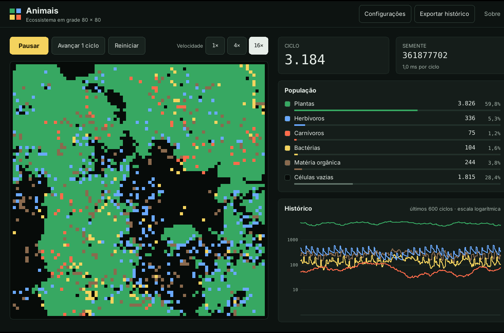
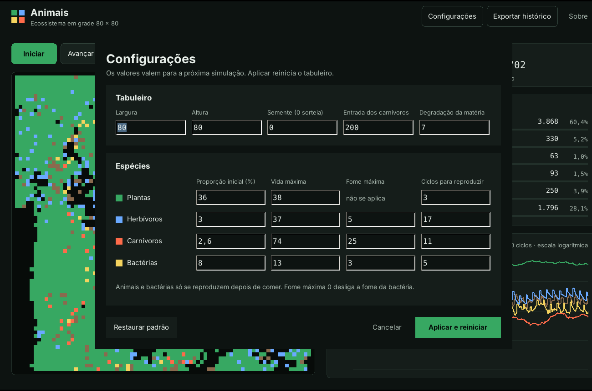

# Animais — um ecossistema em uma grade

**Animais** é uma simulação visual de ecossistema feita em **Lazarus / Free Pascal**. Plantas, herbívoros, carnívoros e bactérias dividem uma grade de 80 × 80 células: comem, passam fome, se reproduzem, morrem e viram matéria orgânica, que as bactérias decompõem. Tudo isso com meia dúzia de regras simples, e o resultado é um mundo que oscila, se reorganiza e, com os parâmetros certos, se mantém vivo por milhares de ciclos.



Outros idiomas: [English](README_EN.md) · [Español](README_ES.md) · [Français](README_FR.md) · [العربية](README_AR.md) · [中文](README_ZH.md)

---

## Objetivos

1. **Mostrar que regras simples geram comportamento complexo.** Nenhum ser "sabe" do ecossistema; cada um só olha as oito células ao redor. Mesmo assim surgem manchas de vegetação, frentes de herbívoros e ciclos de presa e predador.
2. **Ser um laboratório de equilíbrio ecológico.** Todos os parâmetros são editáveis na tela. Dá para testar o que acontece quando os herbívoros vivem mais, quando os carnívoros entram cedo demais ou quando as plantas demoram a se espalhar, e acompanhar o efeito no gráfico.
3. **Servir de exemplo de simulação baseada em agentes em Lazarus.** O motor é pequeno, separado da interface e legível: tipos, tabuleiro, regras, estatísticas e tela ficam cada um em sua unidade.
4. **Demonstrar a biblioteca [`CHATGPT`](https://github.com/marcelomaurin/CHATGPT).** O projeto depende do pacote `openai_simulation` e cada ser herda de `TAISimEntity`. É o ponto de partida para evoluir em direção aos componentes completos da área **AI Simulation**.

---

## Quem vive no tabuleiro

| Cor | Tipo | Papel | Come | Ao morrer de idade ou fome |
|---|---|---|---|---|
| Verde | **Planta** | Produtor | nada | vira matéria orgânica |
| Azul claro | **Herbívoro** | Consumidor | plantas | vira matéria orgânica |
| Laranja-avermelhado | **Carnívoro** | Predador | herbívoros | vira matéria orgânica |
| Amarelo | **Bactéria** | Decompositor | matéria orgânica | apenas some |
| Marrom | **Matéria orgânica** | Resto de ser morto | nada | vira bactéria ao degradar |

São duas cadeias que se fecham uma na outra:

```text
Planta viva  ->  Herbívoro  ->  Carnívoro
Ser morto    ->  Matéria orgânica  ->  Bactéria
```

A bactéria não come planta viva; ela vive do que morre.

---

## As regras

A cada ciclo, todo ser vivo é processado uma vez, nesta ordem:

1. **Envelhece.** Ao atingir a vida máxima do seu tipo, morre. Plantas e animais viram matéria orgânica; bactérias somem.
2. **Come.** Procura uma presa nas oito células vizinhas. Se encontra, a presa some, a fome volta a zero e o ser ocupa o lugar dela.
3. **Passa fome.** Animais e bactérias que não comeram no ciclo acumulam fome. Ao atingir a fome máxima, morrem.
4. **Anda.** Quem não comeu tem 20% de chance de dar um passo para uma célula vizinha livre. Plantas não andam.
5. **Se reproduz.** Quando o contador de reprodução chega ao valor do tipo e há uma célula vizinha livre, nasce um filho. A planta só depende do tempo; **animais e bactérias precisam ter comido** desde a última reprodução.

Regras de apoio:

- A **matéria orgânica** não faz nada além de degradar: depois de alguns ciclos, vira uma bactéria.
- Os **carnívoros entram depois**, em um ciclo configurável (200 no padrão), para dar tempo de plantas e herbívoros se estabelecerem. Se forem extintos, não voltam.
- Cada célula comporta **um ser**. Sem espaço livre ao redor, ninguém nasce.
- O motor é **determinístico**: a mesma semente produz sempre a mesma história.

A descrição completa, com os detalhes de implementação, está em [`docs/REGRAS_JOGO_DA_VIDA_MODIFICADO.md`](docs/REGRAS_JOGO_DA_VIDA_MODIFICADO.md).

### Parâmetros padrão

| Parâmetro | Bactéria | Planta | Herbívoro | Carnívoro |
|---|---|---|---|---|
| Proporção inicial | 8% | 36% | 3% | 2,6% |
| Vida máxima (ciclos) | 13 | 38 | 37 | 74 |
| Fome máxima (ciclos) | 3 | — | 5 | 25 |
| Ciclos para reproduzir | 5 | 3 | 17 | 11 |

A matéria orgânica degrada em 7 ciclos. Com esses valores, os quatro grupos permaneceram vivos aos 10.000 ciclos nas dez sementes testadas (0 a 9). O equilíbrio é sensível: pequenas mudanças podem extinguir um grupo, e descobrir quais é parte da graça.

---

## A tela

- **Tabuleiro** à esquerda, redesenhado a cada ciclo.
- **Controles:** Iniciar/Pausar, Avançar 1 ciclo, Reiniciar e velocidade (1×, 4×, 16×).
- **Cartões** de ciclo, semente e tempo médio por ciclo.
- **População:** quantidade, percentual e barra de cada grupo, incluindo células vazias.
- **Histórico:** gráfico dos últimos 600 ciclos em escala logarítmica, para que grupos pequenos e grandes apareçam juntos.
- **Configurações:** tela para editar todos os parâmetros; aplicar reinicia a simulação.
- **Exportar histórico:** grava um CSV com uma linha por ciclo.

Atalhos: **Espaço** inicia ou pausa, **seta para a direita** avança um ciclo e **R** reinicia.

Cada simulação usa uma semente sorteada, exibida no cartão **Semente**. Para repetir uma execução, informe esse número no campo Semente das configurações.



---

## Como compilar

### Requisitos

- Lazarus e Free Pascal;
- biblioteca [`CHATGPT`](https://github.com/marcelomaurin/CHATGPT), com o pacote `openai_simulation` instalado ou acessível ao Lazarus.

### Passos

```bash
git clone https://github.com/marcelomaurin/animais.git
cd animais
lazbuild src/animal.lpi
```

Ou abra `src/animal.lpi` no Lazarus e compile pela IDE. O executável é gravado em `bin/`.

O projeto procura a biblioteca `CHATGPT` em uma pasta irmã (`..\..\CHATGPT` a partir de `src`). Em outra disposição, ajuste o caminho no `.lpi`.

### Gerar o instalador (Windows)

Com o Lazarus e o [Inno Setup 6](https://jrsoftware.org/isinfo.php) instalados, execute na raiz do projeto:

```bat
gerar_instalador.bat
```

O roteiro compila `src\animal.lpi` e gera `bin\Animais-1.0.0-instalador.exe`. A versão é definida no início de `instalador\animais.iss`, que também pode ser aberto e compilado direto no Inno Setup.

---

## Estrutura do projeto

| Pasta | Conteúdo |
|---|---|
| `src/` | Fontes, projeto Lazarus, ícone e programas de teste. |
| `bin/` | Executável e instalador gerados. |
| `instalador/` | Roteiro do instalador para o Inno Setup (`animais.iss`). |
| `docs/` | Documentação e imagens. |

Principais arquivos em `src/`:

| Arquivo | Responsabilidade |
|---|---|
| `animal.lpr` / `animal.lpi` | Programa principal e projeto Lazarus. |
| `uTipos.pas` | Tipos de ser e a classe `TSer`, que herda de `TAISimEntity`. |
| `uConfig.pas` | `TConfig` e os parâmetros padrão. |
| `uTabuleiro.pas` | Grade com dois estados (atual e próximo). |
| `uSimulacao.pas` | Motor de regras e ciclo da simulação. |
| `uEstat.pas` | Contagem populacional. |
| `form2.pas` / `form2.lfm` | Tela principal, desenhada em código. |
| `uFormConfig.pas` | Tela de configurações. |
| `teste1.lpr` a `teste7.lpr` | Programas de teste do motor. |

---

## Documentação

- [Regras da simulação](docs/REGRAS_JOGO_DA_VIDA_MODIFICADO.md)
- [Guia do usuário](docs/GUIA_USUARIO.md)
- [Guia do desenvolvedor](docs/GUIA_DESENVOLVEDOR.md)
- [Análise técnica](docs/ANALISE_TECNICA.md)
- [Roteiro de desenvolvimento](docs/ROADMAP.md)

---

## Limitações atuais

- As configurações alteradas na tela não são gravadas em disco.
- Os botões da tela principal são desenhados, não controles da LCL; por isso os atalhos de teclado.
- Subespécies, mutações e cenários pré-configurados não fazem parte do código.
- A integração com `openai_simulation` ainda é mínima: herança de `TAISimEntity`.

## Próximos passos

1. Gravar e carregar configurações e cenários em arquivo.
2. Aproximar o tabuleiro dos componentes `TAIGridWorld` e `TAIGridCell`.
3. Trocar regras fixas por um motor de regras configurável.
4. Transformar os programas de teste em testes com verificação automática.

---

## Licença

Distribuído sob a licença **MIT**. Veja o arquivo [`LICENSE`](LICENSE).
