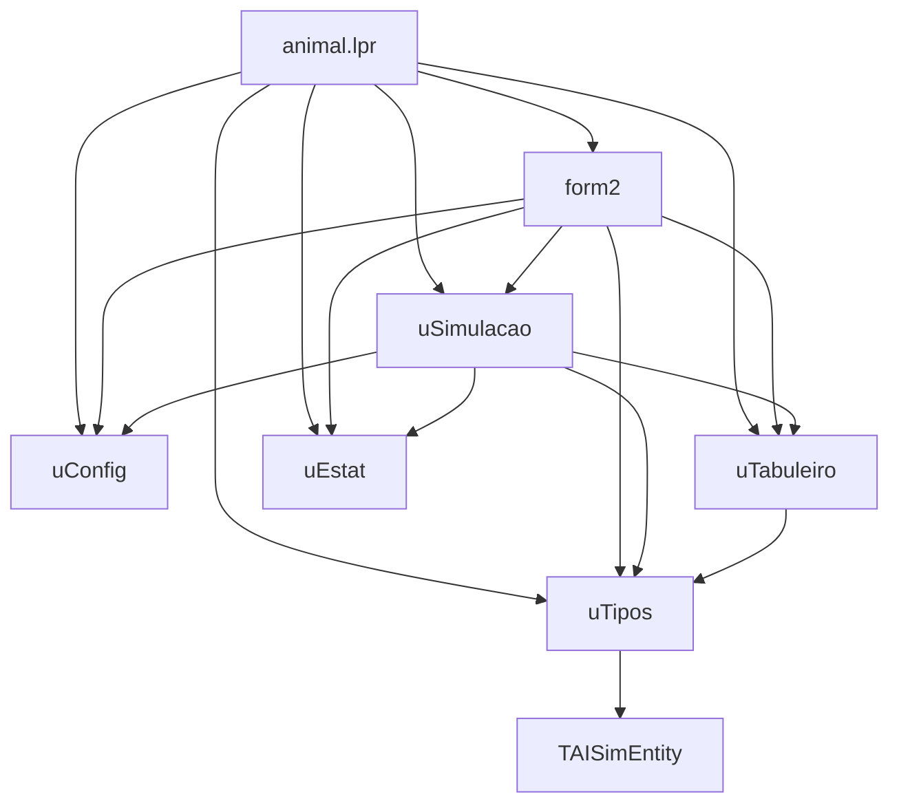

# Guia do Desenvolvedor — Animais

Este documento descreve a arquitetura real da versão atual do projeto **Animais**.

O projeto é uma aplicação Lazarus / Free Pascal que simula um pequeno ecossistema em grade 2D. A versão atual é simplificada e usa as units:

- `uConfig.pas`;
- `uTipos.pas`;
- `uTabuleiro.pas`;
- `uSimulacao.pas`;
- `uEstat.pas`;
- `uFormConfig.pas`;
- `form2.pas` / `form2.lfm`.

Os fontes ficam em `src/`, o executável é gerado em `bin/` e o roteiro do instalador para o Inno Setup fica em `instalador/animais.iss` (`gerar_instalador.bat`, na raiz, compila e grava o instalador em `bin/`).

O projeto também declara dependência do pacote `openai_simulation` e usa `TAISimEntity` como ancestral da classe `TSer`.

---

## Dependências das units



---

## 1. `animal.lpr`

Arquivo principal do programa Lazarus.

Responsabilidades:

- inicializar a aplicação;
- carregar `TForm2`;
- declarar as units usadas pelo projeto.

Units carregadas atualmente:

```pascal
Forms, form2, uConfig, uTipos, uTabuleiro, uSimulacao, uEstat;
```

---

## 2. `animal.lpi`

Arquivo de projeto do Lazarus.

Pontos importantes:

- declara dependência do pacote `openai_simulation`;
- declara dependência de `LCL`;
- inclui as units principais do projeto;
- grava o executável em `..\bin`;
- procura a biblioteca `CHATGPT` em `..\..\CHATGPT\pacote` (pasta irmã do projeto), mantendo o caminho antigo em `P:\` como alternativa.

---

## 3. `uTipos.pas`

Define os tipos básicos da simulação.

### Enum `TTipo`

```pascal
TTipo = (tNada, tBacteria, tPlanta, tHerbivoro, tCarnivoro, tMateria);
```

### Classe `TSer`

A classe `TSer` herda de `TAISimEntity`.

Campos principais:

- `Tipo`: tipo do ser;
- `Idade`: idade atual;
- `VidaMax`: idade máxima;
- `Fome`: contador de fome;
- `FomeMax`: limite de fome;
- `Repro`: contador de reprodução;
- `ReproMax`: ciclo necessário para reproduzir;
- `Morto`: marca se a entidade morreu;
- `Alimentado`: indica que o ser comeu desde a última reprodução (exigido para animais e bactérias se reproduzirem).

Construtor principal:

```pascal
constructor CreateSer(ATipo: TTipo; AVidaMax, AFomeMax, AReproMax: Integer);
```

---

## 4. `uConfig.pas`

Define o record `TConfig` e a função `ConfigPadrao`.

Parâmetros principais:

- `Largura`;
- `Altura`;
- `Seed`;
- `PctBacteria`;
- `PctPlanta`;
- `PctHerbivoro`;
- `PctCarnivoro`;
- `VidaBacteria`;
- `VidaPlanta`;
- `VidaHerbivoro`;
- `VidaCarnivoro`;
- `FomeHerbivoro`;
- `FomeCarnivoro`;
- `FomeBacteria` (0 desliga a fome da bactéria);
- `ReproPlanta`;
- `ReproHerbivoro`;
- `ReproCarnivoro`;
- `ReproBacteria`;
- `DegradaMateria`;
- `CicloEntradaCarnivoro`.

`ConfigPadrao` devolve os valores iniciais. A tela de configurações (`uFormConfig.pas`) edita uma cópia mantida pelo formulário principal.

---

## 5. `uTabuleiro.pas`

Implementa a grade da simulação.

Estrutura interna:

```pascal
FBoard: array of array of TSer;
FNextBoard: array of array of TSer;
```

`FBoard` representa o estado atual. `FNextBoard` representa o próximo estado a ser confirmado no fim do ciclo.

Métodos principais:

- `SetTamanho(AW, AH)`: cria/redimensiona a grade;
- `InBounds(X, Y)`: verifica se a coordenada está dentro da grade;
- `GetSer(X, Y)`: retorna o ser no estado atual;
- `GetSerNext(X, Y)`: retorna o ser no próximo estado;
- `GetSerVivo(X, Y)`: retorna o ser vivo da célula olhando os dois estados (quem já foi processado no ciclo está no próximo);
- `CelulaLivreNext(X, Y)`: verifica se a posição está livre no próximo estado;
- `PrepararProximo`: limpa o próximo buffer;
- `Mover(X, Y, NX, NY)`: move um ser do estado atual para o próximo estado;
- `Colocar(ASer, X, Y)`: coloca um ser no próximo estado;
- `ColocarNoBoard(ASer, X, Y)`: coloca diretamente no estado atual, usado na semeadura inicial;
- `MarcarMorto(X, Y)`: mata o ser vivo da célula, esteja ele no estado atual ou no próximo; quem já tinha migrado vai para a lista `FMortos`;
- `Commit`: troca os buffers e libera os seres marcados como mortos, inclusive os da lista `FMortos`.

### Atenção técnica

- `Mover` inicia `Result := False` e só devolve `True` quando o destino está livre no próximo estado.
- Um ser recém-transformado em matéria orgânica fica, até o `Commit`, com o mesmo ponteiro nos dois estados. `MarcarMorto`, `Commit` e `Destroy` tratam esse caso.
- A busca de presa precisa usar `GetSerVivo`. Usar apenas `GetSer` faz o predador enxergar só 4 das 8 direções, porque os vizinhos já processados migraram para o próximo estado.

---

## 6. `uSimulacao.pas`

Implementa o motor ecológico da simulação.

A classe principal é `TSimulacao`.

Campos principais:

- `FTab`: tabuleiro;
- `FCfg`: configuração;
- `FCiclo`: ciclo atual.

Métodos principais:

- `Create(const ACfg: TConfig)`: cria simulação e semeia o mundo inicial;
- `ExecutarCiclo`: executa um ciclo completo;
- `SemearCarnivoros`: introduz carnívoros no ciclo configurado;
- `Contar`: retorna estatísticas básicas;
- `Semear`: cria a população inicial;
- `ProcessarCelula`: aplica regras de idade, fome, alimentação, movimento e reprodução;
- `MorrerVirandoMateria`: transforma plantas, herbívoros e carnívoros mortos em matéria orgânica;
- `ObterVizinhosLivresNext`: busca posição livre para movimento/reprodução;
- `ObterPreyAdjacente`: busca presa adjacente.

### Fluxo real de `ExecutarCiclo`

1. Incrementa `FCiclo`.
2. Se `FCiclo = CicloEntradaCarnivoro`, chama `SemearCarnivoros`.
3. Chama `FTab.PrepararProximo`.
4. Percorre todas as células de `FBoard`.
5. Para cada ser vivo, chama `ProcessarCelula`.
6. Chama `FTab.Commit`.

### Regras atuais

- Bactérias comem matéria orgânica adjacente.
- Herbívoros comem plantas adjacentes.
- Carnívoros comem herbívoros adjacentes.
- A presa é procurada nas 8 células vizinhas, nos dois estados do tabuleiro.
- Herbívoros, carnívoros e bactérias acumulam fome quando não comem.
- Plantas, herbívoros e carnívoros mortos por idade ou fome viram matéria orgânica; bactérias apenas somem.
- Matéria orgânica degrada e vira bactéria.
- Bactérias, herbívoros e carnívoros podem se mover aleatoriamente.
- Plantas se reproduzem ao atingir `ReproMax`; os demais também precisam ter comido desde a última reprodução (`Alimentado`).

A descrição completa está em `docs/REGRAS_JOGO_DA_VIDA_MODIFICADO.md`.

---

## 7. `uEstat.pas`

Define o record `TEstat`.

Campos:

- `Ciclo`;
- `Bacterias`;
- `Plantas`;
- `Herbivoros`;
- `Carnivoros`;
- `Materia`;
- `Vazios`.

O motor só produz o resumo instantâneo; o histórico por ciclo é guardado pelo formulário principal (`FHist`).

---

## 8. `form2.pas` / `form2.lfm`

Interface principal da aplicação.

O `.lfm` contém apenas o formulário, um `TPaintBox` (`pbTela`) que ocupa toda a janela e o `TTimer`. A tela inteira é desenhada em código, em um bitmap de apoio (`FBuf`) copiado para o `TPaintBox`.

Pontos principais:

- `Desenhar` calcula a disposição a partir do tamanho da janela e chama `DesenharTabuleiro`, `DesenharPopulacao` e `DesenharHistorico`.
- `Botao` desenha um botão e registra sua área em `FBotoes`; `pbTelaMouseDown` procura a área clicada e chama `Acionar`.
- `S(V)` converte medidas de 96 pontos por polegada para a escala do formulário.
- As cores ficam em constantes no início da implementação (`CorPlanta`, `CorHerbivoro` etc.).
- `NovaSimulacao` cria a simulação a partir de `FCfg`, sorteando a semente quando `Seed = 0`.
- `Avancar(K)` executa K ciclos, registra o histórico e mede o tempo médio por ciclo.
- `FHist` guarda um `TEstat` por ciclo; o gráfico usa os últimos 600 e a exportação grava todos.
- `FormKeyDown` trata os atalhos (Espaço, seta para a direita, R).

Para acrescentar um botão: crie um valor em `TBotaoId`, desenhe-o com `Botao` dentro de `Desenhar` e trate-o em `Acionar`.

### Limitações atuais da interface

- Os botões da tela principal não são controles da LCL: não recebem foco pelo teclado (há atalhos) e não aparecem no editor de formulários.
- O desenho usa `FillRect` por célula, não renderização por `ScanLine`.
- O histórico cresce um registro por ciclo, sem limite.

---

## 9. `uFormConfig.pas`

Tela de configurações. A função `EditarConfig(var Cfg: TConfig): Boolean` abre a tela e devolve `True` quando o usuário aplica.

Os controles são criados em código (`Montar`), sem `.lfm`. `Preencher` copia um `TConfig` para os campos e `Ler` valida e devolve o `TConfig` editado. Os botões são `TPanel` planos, para manter as cores do tema.

Ao criar um parâmetro novo em `TConfig`, acrescente o campo em `Montar`, `Preencher` e `Ler`.

---

## Relação com `CHATGPT / openai_simulation`

A integração atual é inicial e direta:

- o projeto depende do pacote `openai_simulation`;
- `TSer` herda de `TAISimEntity`;
- a lógica do projeto demonstra um cenário compatível com conceitos de simulação por agentes.

Ainda não há uso completo de componentes como `TAIGridWorld`, `TAIMovementEngine`, `TAIRuleEngine`, `TAISimulationStats` ou `TAIScenarioConfig`.

Esses componentes podem ser incorporados em uma próxima etapa.

---

## Como adicionar um novo tipo de ser

1. Adicione o novo tipo ao enum `TTipo` em `uTipos.pas`.
2. Atualize `ConfigPadrao`, se o novo tipo precisar de parâmetros próprios.
3. Atualize `TSimulacao.ProcessarCelula` com as regras do novo tipo.
4. Atualize `TSimulacao.Contar` para contabilizar o novo tipo.
5. Atualize `CorDoTipo` e `DesenharPopulacao` em `form2.pas`; para aparecer no gráfico, também `TEstat` e `DesenharHistorico`.
6. Atualize a exportação do histórico e a tela de configurações, se necessário.

---

## Próximos passos técnicos

1. Gravar e carregar configurações em arquivo.
2. Criar renderização mais eficiente usando scanline.
3. Substituir regras fixas por um motor de regras.
4. Migrar gradualmente para os componentes completos de `openai_simulation`.
5. Transformar os `testeN.lpr`7. Transformar os `testeN.lpr` em testes com verificação automática.
